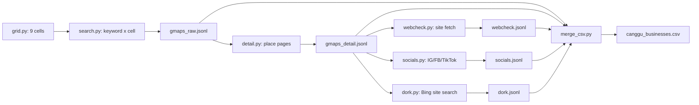

# Canggu Business Scraper — End-to-End Docs

## 1. What this is

Full-code Google Maps scraper. Input: nothing (area + keywords are config).
Output: one CSV of businesses in Canggu with contact signals
(phone, website, emails, WhatsApp links).

Lives in this repo as `mafa_scraper/`. All stages are stdlib + Playwright,
all intermediate state is append-only JSONL, every stage is resumable.

Evolved from the Oct-18 kos hunt ([[kos_blast]]), which used the same
Maps technique by hand and produced `canggu_kos_contacts.csv` (150 rows).

## 2. Scope decisions

- Area = Canggu bbox, no distance math (per explicit decision):
  `lat -8.68..-8.60, lng 115.10..115.18` (`config.py`).
- Membership = coordinates inside bbox. Rows with null coords are kept.
- Non-goals: reviews, hours, pricing, messaging, dedupe by name.

## 3. Architecture



Record key everywhere: the Google Maps place URL. One URL = one business.

## 4. Stage 0 — Discovery (`search.py`)

Grid: bbox split at `CELL_STEP = 0.03` (~3 km) → 3×3 = 9 centers
(`grid.py`). 20 keywords (`config.py`: cafe, restaurant, villa, hotel,
guest house, salon, spa, gym, yoga, coworking, surf shop, minimarket,
laundry, clinic, tattoo, kos, kost, kontrakan, penginapan, indekos).

Per (keyword, cell), Playwright (Chromium headless, Maps UA):

1. `goto https://www.google.com/maps/search/<kw>/@<lat>,<lng>,14z`
   (`domcontentloaded`, 60 s timeout, 4 s settle).
2. Scroll `div[role="feed"]` by 900 px × 10 with 1.2 s pauses.
3. Extract via `page.evaluate`: all `a[href*="/maps/place/"]` in the
   feed → `{name, url, lat, lng}`. Coords parsed from the URL with
   `/!3d(-?\d+\.\d+)!4d(-?\d+\.\d+)/`, fallback `/@(-?\d+\.\d+),(-?\d+\.\d+)/`.
4. Append `{keyword, cell_lat, cell_lng, name, url, lat, lng}` to
   `gmaps_raw.jsonl`. Skip any (keyword, cell, url) already present.

Observed: ~23 s/search, ~40–70 cards/search. Full run: 9 cells × 20
keywords = 180 searches, +9,240 records, 3,010 unique URLs.

Resume: `load_done()` reads existing JSONL into a key set first.

## 5. Stage 1 — Place detail (`detail.py`)

Visits each unique raw URL (3.5 s settle, 2 s throttle between pages):

- `h1` → name (fallback: raw card name).
- `a[href^="tel:"]` → `phone_gmaps` + `alt_phones`.
- All `http` links minus `google.*`/`g.page` → `website_gmaps`
  (first) + `site_links` (up to 10). Instagram/Facebook links survive
  here and feed stage 3.
- `div[role="main"]` innerText (3,000 chars) → `panel_text`, later
  truncated to the `address` column (known wart: contains icon glyphs
  and UI text, not a clean address).

Writes `gmaps_detail.jsonl`. Errors stored inline (`error` field),
never crash the run. Observed ~6 s/page → 3,010 pages ≈ 5 h; actual
run stopped at 1,181 rows per operator decision, remainder are
raw-only rows in the CSV.

## 6. Stage 2 — Website check (`webcheck.py`, stdlib only)

For each detail row with `website_gmaps`: `urllib` GET (15 s timeout,
browser UA, redirects followed), cap 1.5 MB, decode `utf-8/replace`,
unescape HTML entities, then regex:

- Email: `[a-zA-Z0-9._%+-]+@[a-zA-Z0-9.-]+\.[a-zA-Z]{2}` (max 20).
- Phone: `(?:\+62|\(\d{3,4}\)|0\d{2,4})[\s.]?\d{3,4}[\s.]?\d{3,5}`
  (ID-focused; foreign pages yield noise — accepted).
- WhatsApp: `https?://(wa.me|api.whatsapp.com|chat.whatsapp.com)/…`.

Records `website_status` (HTTP code or `error:<type>`), `final_url`,
`has_website` (2xx–3xx). Instagram pages return 200 but contribute
mostly phone noise — see §7.

## 7. Stage 3 — Socials (`socials.py`)

Targets rows that have a social link (`instagram.com`, `facebook.com`,
`fb.com`, `tiktok.com`) in `site_links`/`website_gmaps` AND lack a
real (non-social) website. Playwright per link (45 s timeout):

- `a[href^="mailto:"]` → direct emails.
- `body.innerText` (20k chars) + `og:description` → email regex.
- WhatsApp hrefs → merged into the row's WhatsApp set.
- Login-wall heuristic (short body + login-ish title) → recorded in
  `notes`, not treated as failure.

Writes `socials.jsonl` (`emails_social`, `whatsapp_social`, `notes`).
Reality: IG without login returns a thin page — 6 emails from ~92
rows. Facebook About pages are richer but rarer in this dataset.

## 8. Stage 4 — Search dork (`dork.py`, stdlib only)

For rows with no `website_gmaps`: Bing HTML query
`"<name>" Canggu email OR gmail OR kontak` (`count=10`), strip tags,
email-regex the snippet text, drop `@microsoft/@bing/@live` noise,
3 s delay between queries (politeness + block avoidance).

Writes `dork.jsonl` (`emails_dork`, `query`). Yield is thin by nature
(5 emails / ~490 rows) — small venues have nothing indexed. No API key
needed; SerpAPI would raise recall at a cost.

## 9. Stage 5 — Merge (`merge_csv.py`)

Joins raw + detail + webcheck + socials + dorks on place URL:

- Dedupe: first raw occurrence wins; later keywords append to
  `keyword_hit` with `|` separators.
- Bbox filter: rows with coords outside `BBOX` dropped.
- WhatsApp = website links ∪ social links (deduped).
- `has_website` = has `website_gmaps` link OR successful fetch.
- 17 columns: `name, categories, lat, lng, address, phone_gmaps,
  website_gmaps, website_status, final_url, emails, emails_social,
  emails_dork, phones_all, whatsapp_links, has_website, maps_url,
  keyword_hit`.

Final: **1,883 rows** — 749 phones, 508 websites, 167 any-email
(156 site / 6 social / 5 dork), 176 WhatsApp.

## 10. How to run

```powershell
python -m mafa_scraper.search       # discovery (~70 min)
python -m mafa_scraper.detail       # place pages (~6 s each)
python -m mafa_scraper.webcheck     # stdlib, fast
python -m mafa_scraper.socials      # Playwright, social rows
python -m mafa_scraper.dork         # ~3 s/row, no-website rows
python -m mafa_scraper.merge_csv   # rebuild CSV anytime
```

Options: `--limit N`, `--keyword <kw> --max-cells N` (search),
`--headed` (debug). Long stages run as background jobs; every stage
appends and skips done keys, so reruns continue where they stopped.

## 11. Failure modes

- Maps layout change → `div[role="feed"]` / `/maps/place/` selectors
  in `search.py` and `detail.js` strings are the two fix points.
- Headless blocks / consent walls → rerun affected cells with
  `--headed`, or shrink `CELL_STEP` for denser coverage.
- IG login wall → recorded in `socials.jsonl.notes`; needs a
  logged-in session cookie to go further (not implemented).
- Bing 429s → `note: ERROR:HTTPError` on the row; rerun picks it up.
- `address` column is unparsed panel text — clean or drop before
  sharing externally.

## 12. File inventory

```
mafa-scraper/
  mafa_scraper/
    config.py  grid.py  search.py  detail.py
    webcheck.py  socials.py  dork.py  merge_csv.py
  README.md  Canggu Scraper Docs.md  (this file)
  out/  gmaps_raw.jsonl  gmaps_detail.jsonl
        webcheck.jsonl  socials.jsonl  dork.jsonl
        canggu_businesses.csv
```

Prior art (life vault only, not in this repo): `crawl.py` / `server.py`
in `tmp/crawl4ai-server/` (JS-render fallback used in the Oct-18 kos
run, not wired into this pipeline).

## Related

- [[kos_blast]] — Oct-18 outreach queue built on the same technique
